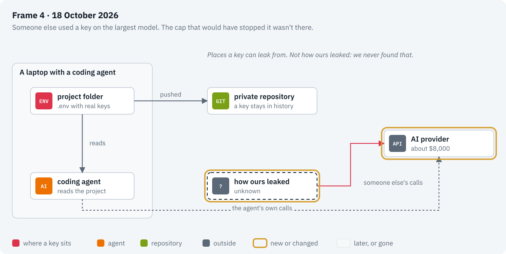

# Part 1: The $8,000 key

A leaked AI key ran up about $8,000 on a project's bill, and we still don't know how it leaked. What we did know: nothing capped what the key could spend.

The lesson of this part: a leaked key's cost isn't set by how it leaked, but by what the key was allowed to do once it was out.



This isn't how our key leaked. It's a map of where a key can sit when you work the way most of us do.

## The exercise: find the keys your agent can see

You look at one of your own projects the way a coding agent sees it. Nothing is changed and nothing costs money. Don't paste any key you find into a chat, a ticket or your notes.

```sh
sh part-1-the-8000-key/find-keys.sh ~/src/my-app
```

It prints paths, commit IDs and variable names, never a value:

1. Every `.env` file in the project, up to three folders down. Each one is inside the agent's reach.
2. For each one, whether Git ignores it. `NOT ignored` means one `git add .` puts it in the history.
3. Every `.env` file ever committed, on any branch. A key in one of those is in every clone, even if the file was deleted later.
4. Every commit that added or removed a key's name. It looks for `OPENAI_API_KEY`, `ANTHROPIC_API_KEY` and `AWS_SECRET_ACCESS_KEY` unless you give your own names:

   ```sh
   sh part-1-the-8000-key/find-keys.sh ~/src/my-app MY_SERVICE_KEY STRIPE_SECRET_KEY
   ```

On a test repo where a `.env` was committed once and then removed, it printed:

```text
== .env files ever committed, on any branch
.env
a key in any of these is in every clone, even if the file was deleted later

== commits that added or removed these names: OPENAI_API_KEY ANTHROPIC_API_KEY AWS_SECRET_ACCESS_KEY
-- OPENAI_API_KEY
fcfd35e 2026-11-24 remove env
45ebeb3 2026-11-24 add env
```

The commit that removed the key still points at the one that added it.

Then write down, for each key you found: where it sits, who owns it, and whether it has a spending cap. Don't write the key itself.

If the script finds a real key in the history, rotate that key first. Then decide with your team whether to clean the history.

## Two fixes

The rest of the series is about these two:

1. Keep the real key out of reach. If the laptop and the agent never hold it, they can't leak it. Parts 2 to 4.
2. Put a limit on every key that remains: a spending cap, a short life, one owner. This one you can set today, in your provider's console.

Next: [Part 2, keep the real key off the laptop](../part-2-keep-the-real-key-off-the-laptop/).
